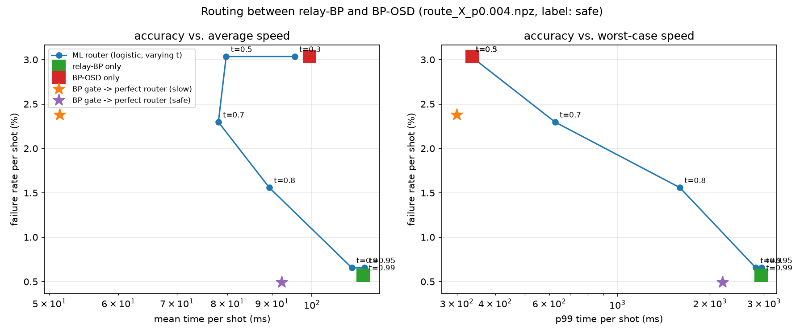
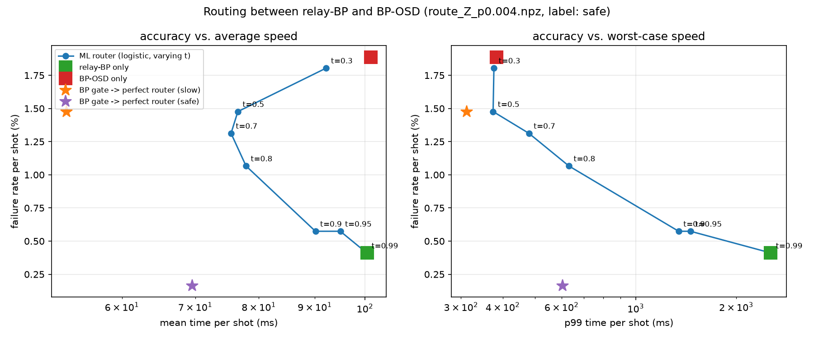

# ML-routed decoding of the [[144,12,12]] Gross code

**MidQWest Quantum Hackathon 2026 · Infleqtion Challenge 1: ML-assisted QEC decoding**

Relay-BP is the most accurate decoder for the Gross code, but a few hard shots take seconds
to decode. BP-OSD has a predictable worst case but makes about 4× more logical errors. We
built a **learned router** that decides, shot by shot, which of the two decoders to use.

## Result at a glance (p = 0.004, 1,000 fresh shots per basis, X + Z memory)

| decoder | failures [X Z] | logical error rate per cycle | mean time | p99 time |
|---|---|---|---|---|
| relay-BP | [3 10] | **1.09e-3** ± 0.30e-3 | 194.5 ms | 3000 ms |
| BP-OSD | [27 26] | 4.53e-3 ± 0.62e-3 | 175.9 ms | **497 ms** |
| **ML router (t = 0.7)** | [18 22] | 3.40e-3 ± 0.54e-3 | **143.4 ms** | 1475 ms |

- **Compared with BP-OSD:** 25% lower logical error rate and 18% faster on average.
- **Compared with relay-BP:** 26% faster on average and half the worst-case (p99) time, at
  about 3× the logical error rate.
- **Fastest of the three on average**, because each shot goes to the decoder that suits it.
- The baselines match the kit's reference values (BP-OSD 4.4e-3, relay-BP 8.7e-4) within
  error bars.

Times are for one X shot plus one Z shot, single process, on a laptop CPU (MacBook Air).

## The pipeline

```
syndrome
   │
   ▼
[1] fast BP (min-sum, 30 iterations, a few ms)
   │
   ├── converged ──────────────► accept BP's answer            (~30% of shots)
   │
   ▼ not converged
[2] router: logistic regression on 6 clues from BP (0.12 ms)
   │
   ├── confidence ≥ t ─────────► BP-OSD    (bounded time)
   └── confidence < t ─────────► relay-BP  (most accurate)
```

**The clues** (`features()` in `src/fast_bp.py`): number of detectors fired, whether BP
converged, number of errors in BP's guess, and three measures of BP's uncertainty taken from
its log-likelihood ratios (mean and minimum |LLR| of the 20 least certain errors, and the
count of errors with |LLR| < 2).

**The label.** A hard shot is labelled **"safe"** if relay-BP is slow on it (top 10% of decode
times) **and** BP-OSD decodes it correctly. Those are the shots that can be moved to BP-OSD
without losing accuracy. One router is trained per memory basis (X and Z).

**The threshold t** trades accuracy for speed: a lower t sends more shots to BP-OSD. We report
t = 0.7. The trade-off plots below show the full range.

## Trade-off plots (p = 0.004)

Each point is a routing policy, replayed on ~1,200 held-out shots. Bottom-left is best. The
blue curve is the router as t varies. The stars are **oracles** that know each shot's outcome
in advance: they can't be built, but they bound what any router could achieve with these two
decoders.

| X memory | Z memory |
|---|---|
|  |  |

- **Average speed (left panels):** the router curve bulges to the left of both decoders, so it
  is faster on average than either.
- **Worst-case speed (right panels):** on X the router roughly interpolates between the two
  decoders. On Z it bends toward the bottom-left: at t = 0.9 it comes close to relay-BP's
  accuracy at about half its p99 time.
- **Gap to the oracle:** a perfect "safe" router would keep relay-BP's accuracy and cut mean
  time by ~20%. Our router doesn't reach that (see Limitations).

## What we learned along the way

1. **For plain BP, the convergence flag is already a perfect router.** We first trained a
   classifier to predict "is BP's answer right?". It did no better than the simple rule "trust
   BP if it converged", which accepted 30% of shots with zero wrong answers on our test set.
2. **Relay-BP's slow shots are the ones BP-OSD gets wrong.** Sending *all* slow shots to
   BP-OSD (oracle "slow") cuts p99 tenfold but quadruples logical errors. That is why we
   label shots "safe" rather than just "slow".
3. **Model choice mattered for speed, not accuracy.** Gradient-boosted trees and logistic
   regression separated the classes about equally well. Logistic regression is 35× faster
   (0.12 ms vs. 4 ms per call), so we use it.
4. **The clues detect "hard", not "safe".** The router reliably spots difficult shots but
   cannot tell which of them BP-OSD will still get right. Richer features are needed for that.

## Resource requirements

| component | cost |
|---|---|
| router model | logistic regression: 7 parameters (6 weights + offset) |
| router inference | 0.12 ms per hard shot, CPU only |
| router training | < 1 s on ~1,800 shots |
| training data | ~3,000 shots per basis per p. Generating it (running all three decoders on every shot) takes ~10 min on 4 cores |
| decoders in memory | fast BP, relay-BP and BP-OSD, all built from the same detector error model |

## Noise sweep

| p | relay-BP rate / cycle | BP-OSD rate / cycle | router rate / cycle | router mean time vs. relay-BP |
|---|---|---|---|---|
| 0.003 | TODO | TODO | TODO | TODO |
| 0.004 | 1.09e-3 | 4.53e-3 | 3.40e-3 | 143 vs. 195 ms |
| 0.005 | TODO | TODO | TODO | TODO |

## Limitations

- **Statistics.** 1,000 shots per basis. The router-vs-BP-OSD accuracy gap is about 1.4
  standard errors, so it is suggestive rather than conclusive. The speed results average over
  every shot and are more robust.
- **No qubit loss.** The challenge highlights loss and heralding. Our circuits use the kit's
  Pauli noise only, without loss.
- **Limited features.** All clues come from plain BP. Clue 2 ("converged") is always 0 for the
  shots the router sees, so effectively 5 clues are used.
- **Python timing.** Latencies include Python overhead and are meant for comparison between
  decoders on the same machine, not as hardware estimates.
- **The worst case is not solved.** p99 improves over relay-BP only by sending hard shots to
  BP-OSD, which costs accuracy.

## Next steps

- Stronger clues: a short trial run of relay-BP (a few legs), the number of alarms left
  unexplained by BP, and detector counts per round.
- Model qubit loss and give the router the loss flags as extra inputs.
- More shots, and the full p sweep for both bases.

## Reproducing the results

Tested with Python 3.12. Relay-BP builds from source and needs a Rust toolchain
(https://rustup.rs). Run all commands from the repository's top folder.

```bash
python3 -m venv .venv && source .venv/bin/activate
pip install -r src/requirements.txt
```

**Evaluate the trained routers live**, using the models in `result/` (~15 min):

```bash
python src/evaluate_router.py --p 0.004 --shots 1000 --t 0.7 \
    --models result/route_X_p0.004_safe_logistic.joblib result/route_Z_p0.004_safe_logistic.joblib
```

**Rebuild everything from scratch:**

```bash
# 1. record fast BP, relay-BP and BP-OSD on every shot (~10 min each on 4 cores)
python src/make_routing_data.py --basis X --p 0.004 --shots 3000 --seed 1 --out result/route_X_p0.004.npz
python src/make_routing_data.py --basis Z --p 0.004 --shots 3000 --seed 2 --out result/route_Z_p0.004.npz

# 2. train the routers, print the policy tables, save models and plots (seconds)
python src/train_router.py result/route_X_p0.004.npz --label safe --model logistic
python src/train_router.py result/route_Z_p0.004.npz --label safe --model logistic

# 3. live evaluation on fresh shots (seed 1000)
python src/evaluate_router.py --p 0.004 --shots 1000 --t 0.7 \
    --models result/route_X_p0.004_safe_logistic.joblib result/route_Z_p0.004_safe_logistic.joblib
```

For another noise level, change `--p`, the seeds and the file names.
`train_router.py --model boosting` compares gradient-boosted trees.

## Files

| file | what it does |
|---|---|
| `src/fast_bp.py` | fast BP decoder and the six router clues |
| `src/make_routing_data.py` | simulates shots and records all three decoders' times and outcomes |
| `src/train_router.py` | trains the router, replays every routing policy, saves the model and trade-off plot |
| `src/evaluate_router.py` | the live routed decoder, scored next to relay-BP and BP-OSD |
| `src/circuit.py`, `src/decoders.py`, `src/circuits/` | from the organizers' decoder kit (unchanged) |
| `src/requirements.txt` | Python packages needed |
| `result/` | recorded data, trained routers and plots for p = 0.004 |

## Credits and references

- Decoder kit (`circuit.py`, `decoders.py`, `circuits/`): MidQWest 2026 Infleqtion challenge.
  The syndrome circuits derive from https://github.com/sbravyi/BivariateBicycleCodes
  (Apache 2.0). The decoder settings follow https://github.com/trmue/relay.
- S. Bravyi et al., *High-threshold and low-overhead fault-tolerant quantum memory*,
  Nature 627, 778 (2024).
- Relay-BP: arXiv:2506.01779.
- Libraries: Stim, ldpc, relay-bp, scikit-learn, NumPy, SciPy, Matplotlib.
