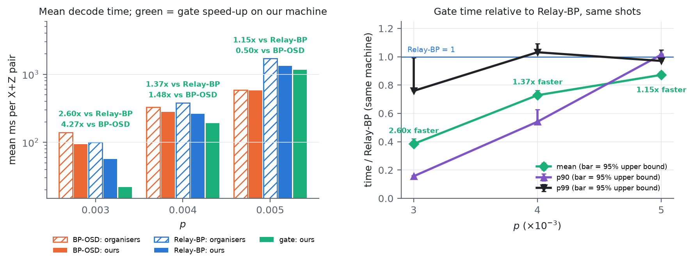
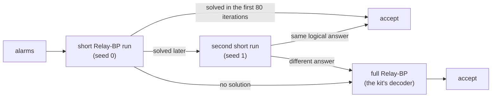
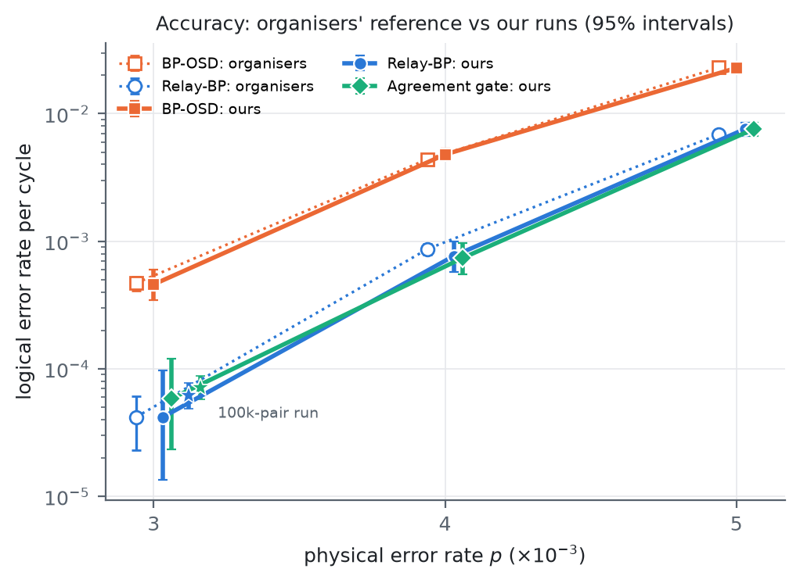
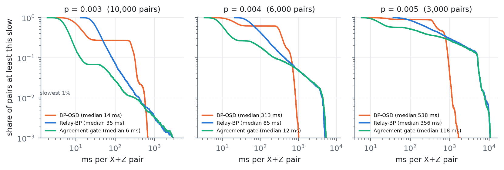
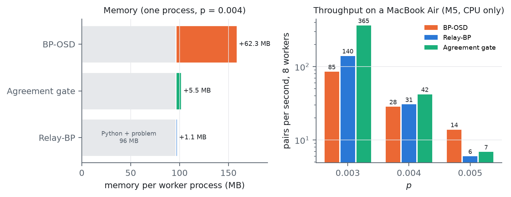

# Agreement Gate: faster decoding for the Gross code

[**Team Heisenbugs · MidQWest Quantum Hackathon 2026 · Infleqtion Challenge 1 (ML-assisted QEC decoding)**](report/slide.pdf)

We built a decoder for the [[144,12,12]] Gross code that is **up to 2.6× faster on average than Relay-BP**, the most
accurate decoder in the challenge kit, while matching its accuracy within our statistical precision. It makes **3–8× fewer errors than BP-OSD**.
It needs no training and no GPU, and adds 5.5 MB of memory per process.



---

## The problem in plain words

- **Qubits are noisy.** Every operation has a small chance `p` of an error (we test p = 0.3%, 0.4% and 0.5%).
- **Error correction spreads information out.** The Gross code stores 12 protected ("logical") qubits in 144 noisy
  data qubits, plus 144 helper qubits that check them.
- **Checks raise alarms.** Each round, the helper qubits measure parities. When an error happens, nearby checks flip.
  These flips are the **syndrome**: 936 alarm bits per run of 12 rounds.
- **A decoder reads the alarms and guesses the errors.** If the guess is wrong in a way that matters, a logical qubit is
  corrupted. That is a **logical error**. We report the **logical error rate per cycle** (lower is better).
- **The decoder must be fast.** A real quantum computer keeps producing new alarms, so a slow decoder falls behind.

The kit gives two baseline decoders:

| Decoder | Accuracy | Speed |
|---|---|---|
| **BP-OSD** | lower | predictable |
| **Relay-BP** | best | slow on hard shots |

## Our idea: the agreement gate

Relay-BP is *randomised*: it runs belief propagation in a series of legs with randomly chosen settings and keeps the
best solution it finds. Most shots are
easy, and a short run finds the right answer quickly. The question is **when to trust a short run**. Our answer is to
ask twice:



- At p = 0.003, **96.5% of shots are accepted in the first 80 iterations**, and only 0.6% reach the full decoder.
- When two runs with different seeds agree on the logical answer, they are rarely both wrong, so errors stay close to
  Relay-BP's level.
- The hard shots still get the full Relay-BP, so nothing is lost on them, but nothing is gained either (see Limitations).

The decoder is one file: [`experiments/gate.py`](experiments/gate.py).

## Results

All decoders ran on **the same simulated shots, on the same laptop** (MacBook Air, Apple M5, CPU only, 8 worker
processes). A "pair" is one X-basis shot plus one Z-basis shot, as in the kit.

| p | pairs | BP-OSD failures | Relay-BP failures | **Gate failures** | **Gate speed-up vs Relay-BP** | Typical (median) pair: gate vs Relay-BP |
|---|---|---|---|---|---|---|
| 0.003 | 10,000 | 55 | 5 | **7** | **2.60×** | 6 ms vs 35 ms |
| 0.004 | 6,000 | 336 | 55 | **53** | **1.37×** | 12 ms vs 85 ms |
| 0.005 | 3,000 | 726 | 262 | **262** | **1.15×** | 118 ms vs 356 ms |

**Accuracy.** Our BP-OSD and Relay-BP numbers reproduce the organisers' reference values. The gate sits on top of
Relay-BP at every noise level. At p = 0.003 failures are so rare that we ran 100,000 pairs: 86 for the gate vs 74 for
Relay-BP, which is too close to call either way.



**Where the time goes.** The gate is much faster on the typical shot. The slowest 1% of shots take as long as with
Relay-BP, because those are exactly the shots that fall back to it.



**Hardware cost.** Building the decoder takes a few milliseconds. Throughput on 8 workers is 365 / 42 / 7 pairs per
second at the three noise levels (Relay-BP: 140 / 31 / 6).



More figures: [speed vs accuracy](figures/4_speed_vs_accuracy.png). The full write-up, with every test and its
statistics, is the **[PDF report](report/report.pdf)**.

## What about machine learning?

The challenge asks for ML-assisted decoding, so we tried ML at three points. Each was compared against a simple rule on
the same shots:

| ML idea | Result |
|---|---|
| Detect the noise level from the alarms, to pick the gate's settings | A small neural network was no better than counting alarms (both within about 3%) |
| Predict which shots will be hard and skip straight to the full decoder | The models found hard shots (AUC about 0.7) but gave no convincing time saving |
| Emma's ML router: send each hard shot to BP-OSD or Relay-BP | Faster than Relay-BP at p ≥ 0.004, but 1.7–8× more logical errors |

**Our conclusion:** under the kit's uniform noise, simple rules already do what ML can do here. ML has a real job when
the hardware gives extra information, such as **qubit-loss flags** from neutral-atom machines. That is our next step:
[qubit-loss plan](docs/plans/qubit_loss.md).

## Limitations

- **The worst case is not improved.** The gate is faster on average and on typical shots, but its slowest 1% matches
  Relay-BP's.
- **Accuracy at p = 0.003 is not proven equal.** Failures are too rare to tell apart even with 100,000 pairs.
- **Uniform noise only, no qubit loss yet.**
- **Python timings.** Compare the decoders with each other on the same machine, not with hardware decoders.

## Run it

Requires Python 3.12. Relay-BP builds from source and needs a Rust toolchain (https://rustup.rs).

```bash
uv venv --python 3.12 .venv && source .venv/bin/activate
uv pip install -r challenge-1-ml-decoder-kit/requirements.txt matplotlib scikit-learn joblib

# the headline comparison at p = 0.004 (about 10 minutes on 8 cores)
python experiments/bposd_compare.py --p 0.004 --shots 6000 --seed 5040 --out data/compare_p0.004.npz
python experiments/bposd_compare_report.py data/compare_p*.npz

# rebuild the summary table and the figures from the saved data
python experiments/metrics_summary.py
python experiments/hardware_figures.py
```

Using the gate in your own code:

```python
from gate import AgreementGate            # experiments/gate.py
gate = AgreementGate(H, L, priors, K=10, referee="R5")   # H, L, priors from kit/circuit.py: dem_matrices
correction = gate.decode(syndrome)
```

## Repository map

| Folder | Contents |
|---|---|
| [`experiments/`](experiments/) | The decoder (`gate.py`) and every study script. Its [README](experiments/README.md) lists them by study. |
| [`figures/`](figures/) | The headline figures shown above |
| [`results/`](results/) | Summary tables and verdicts (`all_metrics.md` has every number) |
| [`data/`](data/) | Saved shots and per-shot outcomes, so results can be re-checked without re-running |
| [`report/`](report/) | The full PDF report and its LaTeX source |
| [`ml_router/`](ml_router/) | Emma's ML router, copied from branch `ml-router` |
| [`results/tail_latency/`](results/tail_latency/) | rarepineapples' tail-latency benchmark |
| [`docs/discussion/`](docs/discussion/) | Every design round between Claude, GPT and Gemini, including the plans written before each test |
| [`docs/plans/`](docs/plans/) | Next steps: [qubit loss](docs/plans/qubit_loss.md) and a [live demo](docs/plans/live_demo.md) |
| [`docs/PROMPTS.md`](docs/PROMPTS.md) | Every prompt used in the project |
| [`challenge-1-ml-decoder-kit/`](challenge-1-ml-decoder-kit/) | The organisers' kit, unmodified (`kit/` links to it) |

## How we worked

Every claim was tested the same way:

1. We wrote down the test and what would count as a pass **before** running it.
2. We ran it on fresh shots the method had never seen.
3. We reported pass, fail or inconclusive with confidence bounds.

The design work was a three-way discussion between Claude (Claude Code), GPT (Codex CLI) and Gemini (agy). Each round
is saved in `docs/discussion/`.

## Team and credits

- **Fernando Velasquez**: the agreement gate, experiments, report (with Claude, GPT and Gemini)
- **Emma Phan**: the ML router (`ml_router/`)
- **rarepineapples**: challenge kit upload, tail-latency benchmark
- **Organisers**: the decoder kit, circuits and baselines (MidQWest 2026, Infleqtion). Circuits derive from
  [sbravyi/BivariateBicycleCodes](https://github.com/sbravyi/BivariateBicycleCodes); Relay-BP settings follow
  [trmue/relay](https://github.com/trmue/relay).
- **References**: Bravyi et al., *High-threshold and low-overhead fault-tolerant quantum memory*, Nature 627 (2024);
  Relay-BP, arXiv:2506.01779.
